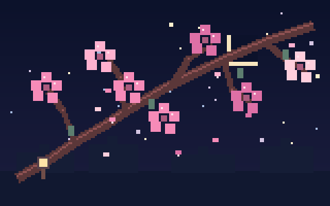

# ✿ Sakura Journal

A tiny pixel-art sakura branch under a quiet night sky. The artwork is regenerated every day by GitHub Actions.

  

The scene is date-seeded: each UTC day gets its own arrangement of blossoms, stars, and drifting petals.

## Run it yourself

1. Copy `.github/workflows/sakura.yml` and `scripts/generate_sakura.py` into your profile repository.
2. Make sure GitHub Actions is allowed to read and write repository contents:
   **Settings → Actions → General → Workflow permissions → Read and write permissions**.
3. Commit and push the files.
4. Open **Actions → ✿ Sakura Journal → Run workflow** to generate the first image.

The generated image is saved at `sakura/sakura.gif`.
